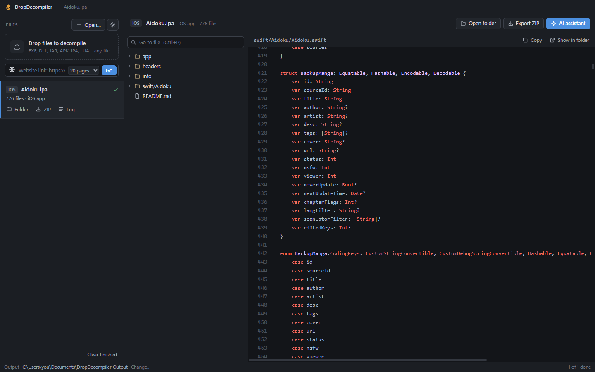
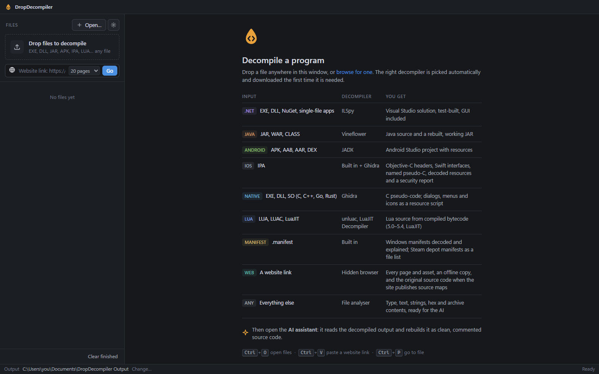
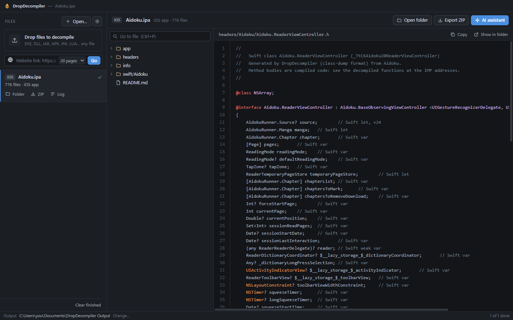
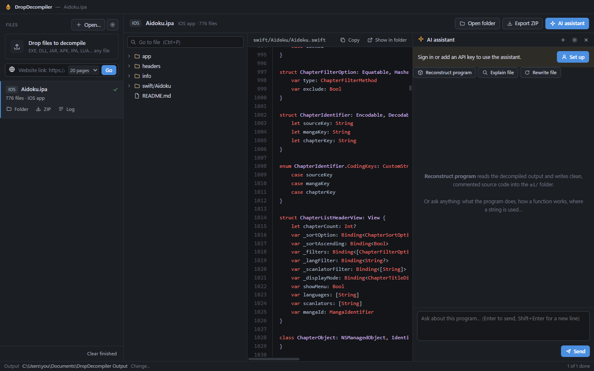
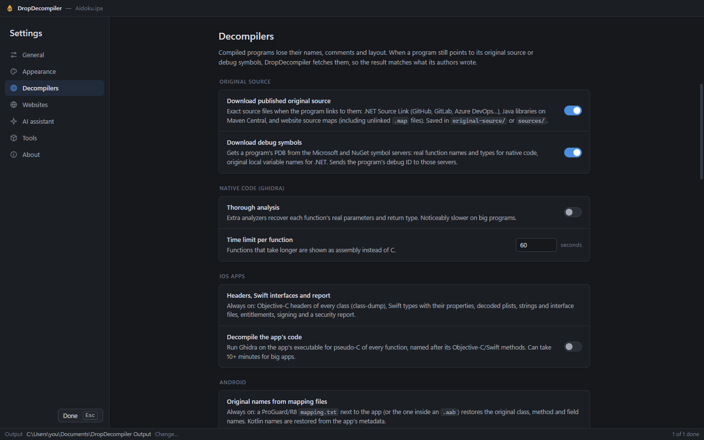

<div align="center">


# DropDecompiler

**Drop a program, an app or a website link. Get its source code back.**

.NET · Java · Android · iOS · native C/C++ · Python · Electron · Lua · websites · and anything else




</div>

DropDecompiler picks the right decompiler for whatever you drop on it, downloads it the first time it's needed, and
gives you a project you can read, browse and often **build again**. When a program still points to its original
source or debug symbols, it fetches them. When an EXE is really Python or JavaScript in disguise, it extracts the
real program. And its AI assistant can rewrite native code and **prove** the rewrite against the original machine
code.

## Highlights

- **One window for everything**: drop several files at once, or a website link; each is detected and processed
  in a queue with live progress, then opened in a built-in source browser.
- **Projects that build**: .NET comes out as a Visual Studio solution that is test-built and fixed automatically;
  Java as a rebuilt JAR that always runs; Android as an Android Studio project.
- **The original when it exists**: exact source files through Source Link, embedded PDB sources, Maven Central and
  source maps; real names from Microsoft/NuGet symbol servers and ProGuard mapping files.
  [More](docs/ACCURACY.md)
- **iOS apps in depth**: class-dump headers, Swift interfaces with exact property types, decoded plists, nibs and
  entitlements, pseudo-C named after its methods, and a security report.
- **What an EXE really is**: compiler and Visual Studio version, original project path, and extraction of
  PyInstaller, Electron, Node, Bun, Deno and Java programs; Delphi forms decoded.
- **Matching decompilation**: the AI assistant rewrites a native function in C, compiles it with Microsoft C/C++
  and compares the machine code with the original until it's identical.
- **Websites**: every page and asset as an offline copy, rendered snapshots, and the original TypeScript/JSX from
  source maps.

## What it decompiles

| You drop | Engine | You get |
|---|---|---|
| .NET `.exe` `.dll` `.nupkg`, single-file apps | [ILSpy](https://github.com/icsharpcode/ILSpy) | A Visual Studio solution, test-built, GUI included |
| Java `.jar` `.war` `.class` | [Vineflower](https://github.com/Vineflower/vineflower) | Java source and a rebuilt, working JAR |
| Android `.apk` `.aab` `.aar` `.dex` | [JADX](https://github.com/skylot/jadx) | An Android Studio project, original names from mapping files |
| iOS `.ipa` | built in + Ghidra | Objective-C headers, Swift interfaces, named pseudo-C, decoded resources, a report |
| Native `.exe` `.dll` `.so` Mach-O (C, C++, Go, Rust…) | [Ghidra](https://github.com/NationalSecurityAgency/ghidra) | C pseudo-code per function, C++ classes, the GUI as a resource script |
| PyInstaller / Electron / Node / Bun / Deno / Java-in-EXE | built in | The real program: Python, JavaScript or Java |
| Lua `.lua` `.luac`, LuaJIT | unluac, LuaJIT Decompiler v2 | Lua source |
| `.manifest` (Windows, Steam, Unity) | built in | Decoded and explained |
| A website link | hidden browser | Offline copy, snapshots, original sources from source maps |
| Anything else | built in | Type, text, strings, hex and archive contents |

Details for each format: [docs/FORMATS.md](docs/FORMATS.md).

## Screenshots

| | |
|---|---|
|  |  |
| Drop a file or paste a link | Class-dump headers, with Swift property types |
|  |  |
| The AI assistant works on the decompiled output | Settings: accuracy options, theme, tools |

## Getting started

### Download

Grab `DropDecompiler-<version>.exe` from the [Releases](../../releases) page. It's the whole app in a single file:
nothing to install. It isn't code-signed, so Windows SmartScreen asks the first time (**More info → Run anyway**).

### Run from source

```bash
git clone <this repository>
cd DropDecompiler
npm install
npm start            # or double-click DropDecompiler.bat
```

Build the portable EXE with `npm run dist` (or an installer with `npm run dist:setup`); it lands in `dist/`.

### Requirements

- Windows 10 or 11 (x64).
- Nothing else for most formats: Java, Ghidra and the decompilers are downloaded on first use into
  `%APPDATA%\drop-decompiler\tools` (Ghidra is about 570 MB, its JDK about 200 MB).
- .NET files need the [.NET SDK](https://dotnet.microsoft.com/download).
- Matching decompilation and the Python decompiler use Visual Studio with the **Desktop development with C++**
  workload, if installed.

## Using it

1. **Drop** files on the window (or `Ctrl+O`), or paste a website link (`Ctrl+V`).
2. Browse the result: `Ctrl+P` jumps to a file; the overview (`README.md` / `BUILD.md`) opens first.
3. **Rebuild** after editing .NET or Java code; **Export ZIP** or **Open folder** to take it elsewhere.
4. Open the **AI assistant** (`Ctrl+I`) to explain code, rewrite a file, or reconstruct the whole program.

Settings (`Ctrl+,`) cover the output folder, theme, accuracy options, the AI account and the downloaded tools.

## AI assistant

A Claude agent that works only inside the output folder: it lists, reads and searches the decompiled files, looks at
the original bytes, and writes what it rebuilds into `ai/`. It can't touch anything else and can't run programs.

- **Reconstruct program**: rewrites the output as a clean project with real names, recovered types and comments,
  plus `ai/README.md` (what the program does, name mapping, what's uncertain).
- **Explain file**, **Rewrite file**, or ask anything.
- For Windows programs built with Microsoft C/C++, it verifies its rewrites with
  [matching decompilation](docs/ACCURACY.md#matching-decompilation) and records exact matches.

Sign in with your Anthropic account in the browser (**Sign in with Anthropic**) or paste an API key. Usage is billed
to that account, and the panel shows the cost of each conversation. Claude Pro/Max chat subscriptions can't be used by
third-party apps.

## Privacy

- Files are decompiled on your PC. Nothing is uploaded unless you use the AI assistant, which sends the files it
  reads to Anthropic's API.
- Optional downloads (on by default, in Settings): debug symbols (the program's debug ID is sent to the Microsoft /
  NuGet symbol servers) and published original sources (from the locations the program names).
- Websites are loaded in an isolated session without your cookies or logins.
- API keys are stored encrypted with Windows DPAPI.

## Documentation

- [Formats](docs/FORMATS.md): what each input produces
- [Accuracy](docs/ACCURACY.md): original sources, symbols, matching decompilation, and the limits
- [Architecture](docs/ARCHITECTURE.md): how the code is organized

## Contributing

Issues and pull requests are welcome. Before opening a pull request, run `npm run check` (a syntax check of every
file; CI runs it too). The engine in `src/` is plain Node.js, so most changes can be tried from a script without
starting the app (see [Architecture](docs/ARCHITECTURE.md)).

## Responsible use

Decompile software you own or have permission to analyse, and respect its license. DropDecompiler doesn't remove
DRM or protections: encrypted apps and protected programs are identified, not unlocked.

## License

[MIT](LICENSE). DropDecompiler downloads and runs other open-source tools under their own licenses; see
[THIRD-PARTY-NOTICES.md](THIRD-PARTY-NOTICES.md).
